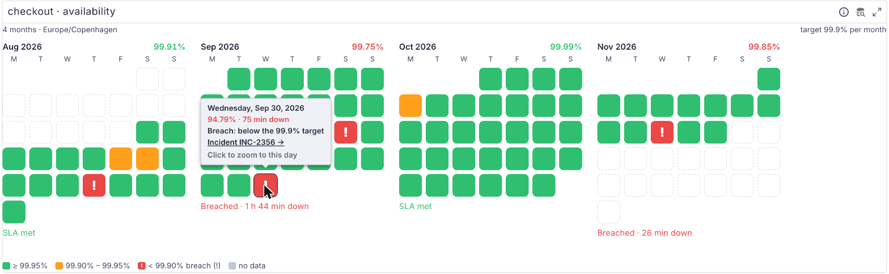
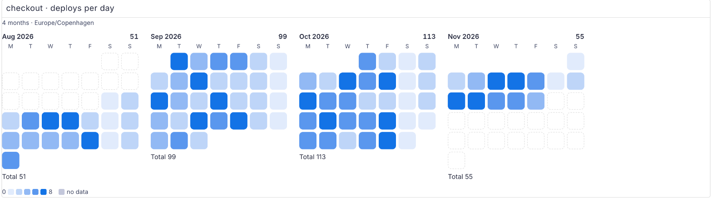
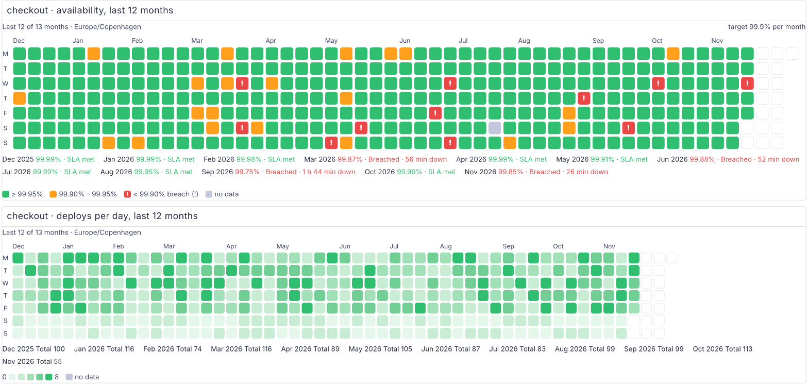

# perses-plugin-calendarheatmap

A [Perses](https://perses.dev) panel plugin, `CalendarHeatmapChart`, that draws a time range as
calendar months: one square per day, coloured by availability against an SLA target, with each
month's total next to the target. SLAs are agreed per calendar month, but dashboard time ranges are
rolling; this panel reads the way an SLA report does. The same panel draws "deploys per day" or
"incidents per day" in the GitHub-contributions style.

<picture>
  <source media="(prefers-color-scheme: dark)" srcset="docs/screenshots/availability-months-dark.png">
  
</picture>

```promql
# Availability per hour; the panel pools the hours into days and months
avg_over_time(probe_success{instance="api"}[1h])
```

## Supported versions

| Plugin | Perses  | Status              |
| ------ | ------- | ------------------- |
| 0.1.x  | v0.55.x | Tested with v0.55.1 |

The plugin is built against `@perses-dev/*` 0.55.1 and `percli` v0.55.1. Other Perses minor versions
may work but are not tested.

## What it does

- **Availability mode** (`mode: availability`): each day is green when it meets the target and the
  warn level, amber when it meets the target but is below `warnBelow` ("close"), and red with a
  **!** when it is below the target. Days with no data are grey, never green. Each month shows its
  total availability, coloured met or breached, and "SLA met" or "Breached · N min down".
- **Month totals come from the raw samples**, not from the daily percentages: all of the month's
  samples are pooled, so a day with fewer samples weighs less. Downtime is
  (1 − availability) × the minutes of the period that the time range covers.
- **Count mode** (`mode: count`): any series, reduced per day and per month with `reduce` (`sum`,
  `max` or `mean`), on a five-step sequential scale from a theme palette (`colorScale`). Zero has its
  own faint step, so it never looks like a day with no data.

  <picture>
    <source media="(prefers-color-scheme: dark)" srcset="docs/screenshots/count-months-dark.png">
    
  </picture>

- **Layouts** (`layout`): `months` (default) puts the months side by side and wraps them; `year` draws
  one long strip, a column per week and a row per weekday, with the month totals listed under it.
  Up to 12 months are drawn; with a longer range the last 12 are shown and the panel says how many it
  left out.

  <picture>
    <source media="(prefers-color-scheme: dark)" srcset="docs/screenshots/year-dark.png">
    
  </picture>

- **Hover a day** for its date, availability and downtime (or its value in count mode), the clock
  change on a 23- or 25-hour day, and the incidents of that day with their links.
- **Click a day** (or focus it and press Enter or Space) to zoom the dashboard to that day, so the
  other panels show what happened. With `dayLink`, a day opens that link instead.
- **Incidents** (optional): a second query marks the days on which an incident was open (any sample
  above 0). `incidents.label` names it from a series label, `incidents.link` turns it into a link.
  Without a second query, `incidents.link` is shown on breach days, for example a link to an
  incident search for that day.
- **Time zones**: day and month boundaries are computed in `timezone`, or in the dashboard's time
  zone when unset. DST days have 23 or 25 hours and are counted as such; a day that only partly
  overlaps the time range is judged on the part it covers.
- Days outside the time range keep their place with a dashed outline, so each month stays a
  calendar. The current month is judged on the minutes so far.
- Status never relies on colour alone: breach days carry a **!**, every day has an accessible name
  ("Sep 30, 2026: 94.79%, breach, below 99.9%, 75 min down"), and the legend names every colour.
- Light and dark themes follow Perses; every colour comes from the MUI theme.

## Data it expects

The panel asks its queries for one sample per hour (`suggestedStepMs` of one hour), whatever the
panel width, so a year stays under Prometheus' 11,000 points per series. Write the query over the
same one-hour window, so each sample covers the hour before it:

| Mode         | Query                                                                        |
| ------------ | ---------------------------------------------------------------------------- |
| availability | `avg_over_time(probe_success{instance="api"}[1h])`                           |
| availability | `1 - slo:sli_error:ratio_rate1h{slo="api"}` (Pyrra or Sloth recording rules) |
| availability | `slo:sli_error:ratio_rate1h{slo="api"}` with `valueType: errorRatio`         |
| count        | `sum(increase(deploys_total[1h]))`                                           |
| incidents    | `max by (incident) (max_over_time(incident_open[1h]))` as a second query     |

- Availability can be 0..1 or 0..100: values above 1 are read as percent. `valueType: errorRatio`
  reads the series as 1 − availability.
- Several series in the first query are pooled, sample by sample, into one calendar.
- A sample at `t` is put on the day of `t − step / 2`, so the 00:00 sample, which covers the hour
  before midnight, belongs to the day before.

### Spec

```yaml
kind: CalendarHeatmapChart
spec:
  mode: availability # required; availability | count
  valueType: availability # availability | errorRatio; availability mode
  target: 99.9 # percent; availability mode
  warnBelow: 99.95 # percent; days between target and this are "close"
  layout: months # months | year
  weekStart: monday # monday | sunday
  timezone: Europe/Berlin # IANA zone, UTC or local; unset = the dashboard's
  dayLink: "/projects/sre/dashboards/day?start=${from}&end=${to}" # unset = zoom to the day
  incidents:
    label: incident # series label that names the incident
    link: "https://status.example.com/incidents/${incident}"
  # count mode
  reduce: sum # sum | max | mean
  colorScale: success # success | info | primary | warning | error
  format: { unit: decimal, decimalPlaces: 0 } # Perses format (common.#format)
```

`dayLink` and `incidents.link` replace `${day}` (`2026-09-30`), `${from}` and `${to}` (the day's
bounds in Unix milliseconds) and `${incident}`, URL-encoded; dashboard variables are replaced by
Perses. Only `http(s)` and relative links are followed. Every option has an editor in the panel
settings. The CUE schema is `schemas/panels/calendar-heatmap-chart/calendar-heatmap-chart.cue`, with
an example next to it and valid and invalid cases under `tests/`.

## Try it locally

`dev/` runs Perses with the plugin and a Prometheus that starts with 400 days of made-up SLA history
for a `checkout` service: hourly availability with a few breach days, close days and short blips, one
long outage with its incident, a two-day gap without data, and deploys per day. The history is
backfilled with `promtool` on the first start. The screenshots above come from it. It needs
`podman compose` or `docker compose`.

```bash
npm ci && npm run build && percli plugin build
cp CalendarHeatmap-*.tar.gz dev/archive/
podman compose -f dev/docker-compose.yaml up -d    # PERSES_PORT=18090 to move it off 18085
```

Open <http://localhost:18085/projects/demo/dashboards/sla-calendar> (90 days, months layout) or
`sla-year` (one year, year layout). Each has an availability panel and a deploys panel. The backfill
takes a few seconds before Prometheus answers. `podman compose -f dev/docker-compose.yaml down -v`
removes it again, history included.

## Build

```bash
npm ci
npm test               # Jest: calendar, data, links, format and the components
npm run build          # module-federation bundle in dist/
percli plugin test-schemas
percli plugin build    # writes CalendarHeatmap-<version>.tar.gz
```

See `CONTRIBUTING.md` for the checks and the release process, and `docs/DECISIONS.md` for how the
numbers are computed.

## Install into Perses

Perses extracts every `*.tar.gz` in `plugin.archive_paths` into `plugin.path` at startup. Setting
`archive_paths` replaces the default, so keep the directory of bundled plugins in the list. Pick one
of the three options below and restart Perses.

### Option A: release archive

Download `CalendarHeatmap-<version>.tar.gz` from the
[GitHub releases](https://github.com/astrona-io/perses-plugin-calendarheatmap/releases), put it in a
directory Perses can read, and add that directory to the config:

```bash
curl -fLO https://github.com/astrona-io/perses-plugin-calendarheatmap/releases/download/v0.1.0/CalendarHeatmap-0.1.0.tar.gz
```

```yaml
plugin:
  archive_paths:
    - /etc/perses/plugins-archive # plugins bundled with Perses
    - /etc/perses/plugins-archive-calendarheatmap # put CalendarHeatmap-0.1.0.tar.gz here
```

### Option B: Kubernetes image volume

The `Containerfile` packages the archive as a plugin-only OCI image (`FROM scratch`, the archive at the
image root). Every release publishes it as
`ghcr.io/astrona-io/perses-plugin-calendarheatmap:v<version>` for linux/amd64 and linux/arm64, so you
can use that image directly. To build and push it to your own registry instead:

```bash
percli plugin build
podman build -t ghcr.io/<owner>/perses-plugin-calendarheatmap:<version> .
podman push ghcr.io/<owner>/perses-plugin-calendarheatmap:<version>
```

Then mount it into the Perses pod as an
[image volume](https://kubernetes.io/docs/concepts/storage/volumes/#image) and add the mount path to
`archive_paths` as in option A. Image volumes need a cluster and container runtime that support them
(the `ImageVolume` feature; check your Kubernetes version and feature gates).

```yaml
volumes:
  - name: calendarheatmap-plugin
    image:
      reference: ghcr.io/astrona-io/perses-plugin-calendarheatmap:v0.1.0
      pullPolicy: IfNotPresent
containers:
  - name: perses
    volumeMounts:
      - name: calendarheatmap-plugin
        mountPath: /etc/perses/plugins-archive-calendarheatmap
        readOnly: true
```

### Option C: custom Perses image

Copy the archive into the directory of bundled plugins. No config change is needed, because that
directory is in the default `archive_paths`:

```dockerfile
FROM persesdev/perses:v0.55.1
COPY CalendarHeatmap-0.1.0.tar.gz /etc/perses/plugins-archive/
```

## Licences and credits

The plugin is Apache-2.0 (`LICENSE`). Third-party material and its notices are listed in `NOTICE`:
the Perses shared CUE schemas, vendored into the archive at build time (Apache-2.0).
